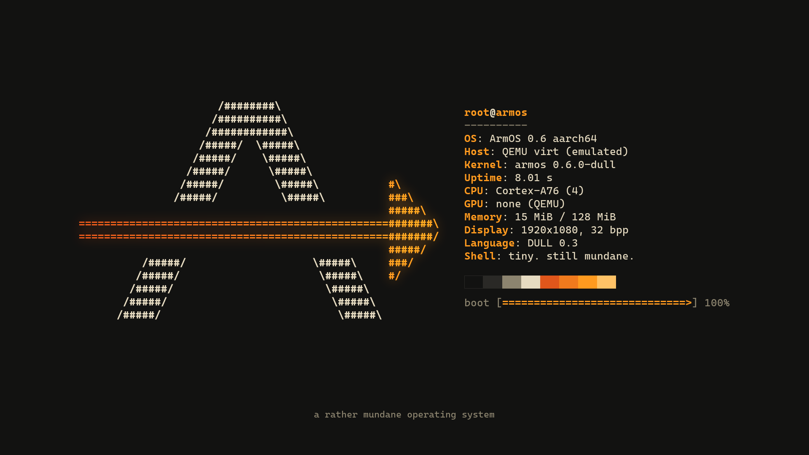
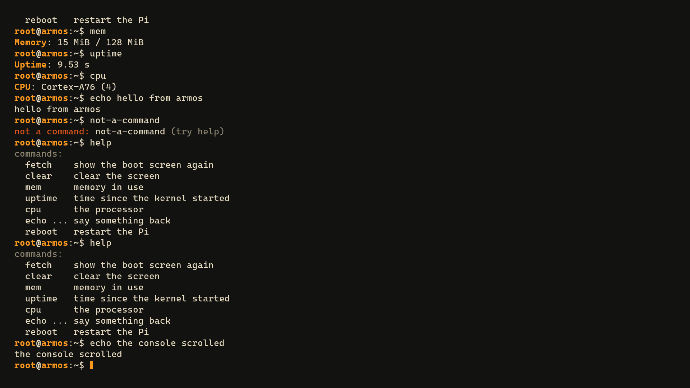
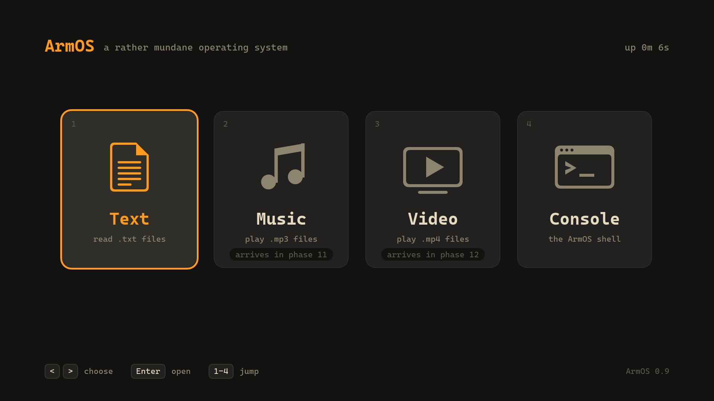
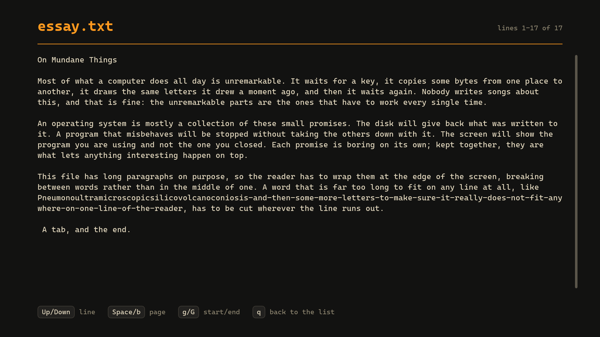
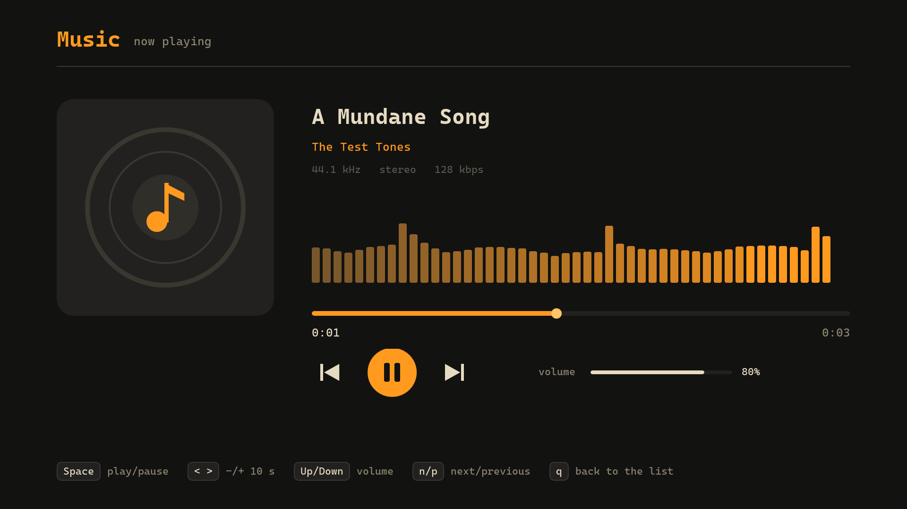

# arm-os
a rather mundane operating system

A from-scratch OS for the Raspberry Pi 5, with its own language and toolchain.

- [Scope](docs/SCOPE.md) - what done means, phases, risks, open questions
- [Language spec v0.2](docs/LANGUAGE.md) - DULL, the systems language ArmOS is written in
- [dullc](dullc/README.md) - the DULL compiler, assembler and linker, written in DULL
- [Stage 0](stage0/README.md) - the Python tools that bootstrap dullc, and how to run the tests

## Running it on a Raspberry Pi 5

You need a Raspberry Pi Debug Probe on the Pi's 3-pin UART header and a FAT32 microSD card.

1. Once: `python tools/build_pi5.py --loader --card F:` puts the serial loader on the card (use your card's drive letter).
2. Every build: `python tools/build_pi5.py --send COM4` builds the kernel, sends it over the cable and shows what it prints.
   A running ArmOS kernel reboots into the loader on request, so the card stays in the Pi.

## What it looks like

The boot screen (the arrow through the A is the progress bar; every fact on the right is read from the hardware) and the console, rendered by the kernel itself:

After boot, the launcher (Text, Music, Video, Console) and the text reader, also drawn by ArmOS itself:

Type at the console over the serial cable: `python -m serial.tools.miniterm COM4 115200`.

The shell can read the SD card: `disk` shows the card and its file system, `ls [folder]` lists files and `cat file` prints one (`help` lists the rest).

A USB keyboard and mouse drive it (point and click, the wheel scrolls, right-click goes back), as do arrow keys over the serial cable; the Console tile opens the shell. Plug them straight into the Pi: USB hubs are not supported yet. Music plays .mp3 files from the SD card over HDMI (the TV's or monitor's speakers); `tone` in the shell plays a test chime. The shell is an app, like everything outside the kernel: it starts other apps by name (`hello`, `spin a 5 &` in the background), and `ps` / `kill` manage them. See [apps/](apps/README.md) for writing one.

The console font, ArmOS Mono, is baked from Cascadia Mono and Cascadia Code (SIL Open Font License 1.1, see [fonts/](fonts/)).
